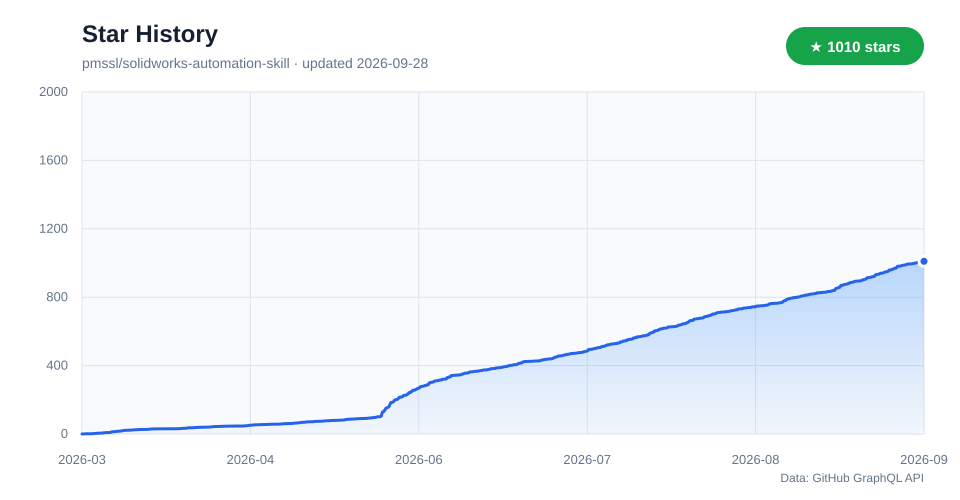
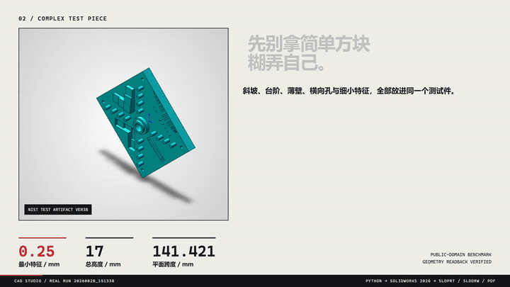

# SolidWorks Automation Skill

[](https://opensource.org/licenses/MIT)
[](https://www.python.org/downloads/)
[](https://www.solidworks.com/)

通过 SolidWorks Automation Skill 使用本机 Python CLI 和 COM。可执行范围见 capabilities.yaml。

> 本项目当前能做什么、需要哪些环境、哪些能力必须人工复核，请先阅读 [项目能力、环境与使用条件](docs/PROJECT_CAPABILITIES_AND_ENVIRONMENT.md)。

> 可靠性边界：当前真机基线为 SolidWorks 2024、SolidWorks 2026 SP01.1 和 AutoCAD 2024。SolidWorks 2026 仅对能力清单中列出 2026 的能力视为已验证；SolidWorks 2025 及其余未回归能力仍是兼容性目标。配置族、钣金 U 型轮廓法兰/展开 DXF，以及 HSS 矩形焊接框架/切割清单已进入 `pilot`；设计表与复杂钣金/焊件仍是兼容目标。C# Add-in 宿主已在 SW2026 SP1.1 完成进程内 callback、应用事件、CommandGroup、TaskPane、PropertyManagerPage 和 JSON 诊断回归；正式部署必须使用 64 位 RegAsm `/codebase /tlb`。Simulation/FEA、Routing、复杂曲面和模具也处于受控 `pilot` 门禁，不能冒充原生完整交付。

## 下载与首次启动

可使用 Skill 或 CAD Studio 桌面版：

| 入口 | 适合用户 | 下载/安装 |
|---|---|---|
| Skill | 已在使用支持 skill 导入的客户端 | `npx github:pmssl/solidworks-automation-skill`，或 `claude skill add https://github.com/pmssl/solidworks-automation-skill` |
| CAD Studio 桌面版 | 希望用图形界面管理项目、对话、任务、预览和交付 | 从 [GitHub Releases](https://github.com/pmssl/solidworks-automation-skill/releases) 下载 Windows 安装包或便携 ZIP |

进入 Skill 目录后执行环境诊断：```powershell
python scripts/cad_doctor.py
python scripts/cad_studio.py doctor
```

诊断结果中的 `remediations` 会列出缺失项、影响范围、官方地址和可复制的安装命令。缺少 SolidWorks/AutoCAD 时只阻断对应原生格式，STEP/IGES/BREP/STL/OBJ/GLB/DXF/SVG/PDF/PNG 等开放格式仍可继续。桌面端会在“设置”和“帮助”中显示相同建议。

需要提交问题时，再生成脱敏诊断包：

```powershell
python scripts/cad_studio.py export-diagnostics --output .\cad-studio-diagnostics.zip
```

诊断包只包含版本、阶段、错误码和耗时等脱敏信息，不包含 Prompt、模型内容、API Key 或完整私人路径。

队列任务也可脱离桌面端操作：

```powershell
python scripts/cad_studio.py status
python scripts/cad_studio.py run --enable-mock
python scripts/cad_studio.py retry <job-id>
python scripts/cad_studio.py cancel <job-id>
python scripts/cad_studio.py write-open-format --input .\part.cadstudio.json --out-dir .\output
python scripts/cad_studio.py preview-dxf --input .\drawing.dxf --output .\output\drawing.scene.json
python scripts/cad_studio.py check-dfm --input .\part.cadstudio.json --output .\output\dfm.json --profile .\supplier-profile.json
python scripts/cad_studio.py check-routing --input .\route.json --output .\output\routing_report.json
python scripts/cad_studio.py fea-preflight --solver auto
python scripts/cad_studio.py prepare-fea --input .\fea.json --out-dir .\output\fea
python scripts/cad_studio.py run-fea --input .\fea.json --out-dir .\output\fea --timeout 120
python scripts/cad_studio.py run-fea-convergence --input .\fea-convergence.json --out-dir .\output\fea-convergence --timeout-per-case 120
python scripts/cad_studio.py review-advanced-geometry --input .\surface-plan.json --output .\output\surface_report.json
python scripts/cad_studio.py create-ocp-loft --input .\loft.json --out-dir .\output\loft
python scripts/cad_studio.py create-ocp-surface --input .\smooth-loft.json --out-dir .\output\surface
```

<p align="center">
  
  <br>
  <strong>关注抖音 @balance.</strong>
  <br>
  <sub>嵌入式开发、SolidWorks 自动化和 AI 辅助工程实践持续更新</sub>
</p>

[English](#english) | [中文](#中文)

> **CAD Studio 桌面版**：下载、环境要求和完整操作流程见 [CAD Studio 用户说明书](docs/CAD_STUDIO_USER_MANUAL.md)。Windows 安装包与便携 ZIP 发布在 [GitHub Releases](https://github.com/pmssl/solidworks-automation-skill/releases)。

---

## 中文

### 🎯 使用示例

#### 推荐写法：Session API

```python
import sys
sys.path.insert(0, r"./scripts")

from sw_preflight import run_preflight
from sw_connect import mm
from sw_part import sketch, sketch_circle, extrude_boss
from sw_session import SolidWorksSession

run_preflight()
session = SolidWorksSession()
model = session.new_part()

with sketch(model, "Front Plane") as sketch_name:
    sketch_circle(model, 0, 0, mm(25))

extrude_boss(model, sketch_name, mm(50))
session.save(model, r"C:\temp\cylinder.sldprt")
session.export(model, r"C:\temp\cylinder.step")
```

#### 多模型 VBA 宏防护

当需要由 GPT / Kimi / Claude 生成 SolidWorks VBA 宏时，先使用 `sw_macro_guard.py` 统一处理格式差异：

```python
from sw_macro_guard import build_prompt, fallback_macro_for_request, validate_vba_macro

prompt = build_prompt("画一个 50mm 圆柱", model_name="claude")
macro = fallback_macro_for_request("画一个 50mm 圆柱")
result = validate_vba_macro(macro)
assert result.ok, result.issues
```

策略：

- GPT 系列沿用简洁提示词。
- Kimi / Claude / 未知模型自动使用强格式约束 Prompt，只允许输出 VBA 源码。
- 校验 `SldWorks`、`ModelDoc2`、`Sub`、`End Sub` 后再执行。
- 模型输出解析失败时自动重试 `1~2` 次；仍失败则按“立方体 / 圆柱 / 拉伸 / 草图”等关键词调用本地模板兜底。

#### 创建零件

```python
from sw_connect import connect_solidworks, mm, new_document
from sw_part import *

sw, _ = connect_solidworks()
model = new_document(sw, "part")

# 绘制草图
start_sketch(model, "Front Plane")
sketch_circle(model, 0, 0, mm(25))
end_sketch(model)

# 拉伸
extrude_boss(model, "Sketch1", mm(50))
```

#### 装配体操作

```python
from sw_connect import connect_solidworks, new_document
from sw_assembly import add_component, add_mate_coincident

sw, _ = connect_solidworks()
asm = new_document(sw, "assembly")

# 添加零件
comp1 = add_component(asm, r"C:\parts\part1.sldprt", 0, 0, 0)
comp2 = add_component(asm, r"C:\parts\part2.sldprt", 0.1, 0, 0)

# 添加配合
add_mate_coincident(asm, "Face1@part1", "FACE", "Face1@part2", "FACE")
```

#### Motion Study 旋转马达

```python
from sw_connect import mm
from sw_motion import (
    create_motion_study,
    add_constant_speed_rotary_motor_by_cylinders,
    calculate_and_play,
)

# 前提：叶轮已通过同心 Mate 装到轴上，且 lock_rotation=False。
study = create_motion_study(asm, name="叶轮_60RPM_循环转动", duration=4.0)
add_constant_speed_rotary_motor_by_cylinders(
    study,
    shaft_component=stand_comp,
    rotor_component=impeller_comp,
    shaft_radius=(mm(4.5), mm(5.5)),
    rotor_radius=(mm(10.5), mm(11.5)),
    rpm=60.0,
    name="叶轮旋转马达_60RPM",
)
calculate_and_play(study)
```

#### 导出文件

```python
from sw_connect import connect_solidworks, open_document
from sw_export import export_to_step, export_to_stl

sw, _ = connect_solidworks()
model = open_document(sw, r"C:\parts\mypart.sldprt")

# 导出 STEP
export_to_step(model, r"C:\output\mypart.step")

# 导出 STL
export_to_stl(model, r"C:\output\mypart.stl", quality="fine")
```

### 🔑 核心概念

#### 单位转换

SolidWorks API 使用**米**作为基本单位,使用辅助函数进行转换:

```python
from sw_connect import mm, deg

length = mm(50)      # 50mm → 0.05m
angle = deg(90)      # 90° → 1.5708 弧度
```

#### 实体选择

操作特征前需要先选择实体:

```python
model.Extension.SelectByID2(
    "Front Plane",  # 实体名称
    "PLANE",        # 实体类型
    0, 0, 0,        # 坐标
    False,          # 追加选择
    0,              # 标记
    None,           # 标注
    0               # 选择标记
)
```

#### 基准面名称

| 英文版 | 中文版 | 法线方向 |
|--------|--------|----------|
| Front Plane | 前视基准面 | Z 轴 |
| Top Plane | 上视基准面 | Y 轴 |
| Right Plane | 右视基准面 | X 轴 |

从当前版本开始，`start_sketch()` 会自动在中英文默认基准面名称之间兜底切换，更适合代理在不同语言版本的 SolidWorks 中执行。

### 🛠️ 高级功能

- **批量处理**: 批量打开、转换、导出文件
- **外观材质**: 设置文档、特征、组件级颜色；复杂颜色建议拆成多零件装配体
- **配置管理**: 创建和切换配置,修改配置参数
- **自定义属性**: 读写零件属性,支持配置特定属性
- **设计表**: 通过 Excel 驱动参数化设计，仍需专项回归后才能无人值守交付
- **钣金展开**: 导出 DXF 展开图用于激光切割
- **仿真分析**: CalculiX 2.23 已真实执行线性静力、NLGEOM、受限塑性、面接触和网格序列，并读取最终步 COPEN/CPRESS/CSLIP；大型接触、全过程穿透允许值、屈曲、模态与热耦合仍未完成，不能作为安全认证
- **CAD Agent 自审查**: 自动导出多视角预览图、生成 `review_report.json`、给出 `pass/warn/fail` 与修复建议
- **API 查证工作流**: 对尚未封装的 SolidWorks API，先查官方 API Help / 本地 SDK，再写最小验证脚本并沉淀稳定封装

详见 [references/](./references/) 目录下的完整文档。

### 🔎 Agent API 查证约定

本 skill 不把 SolidWorks 全量 API 硬塞进上下文。遇到 `scripts/` 里尚未封装的接口时，代理应先读取 [`references/api-lookup.md`](./references/api-lookup.md)，再查询 SolidWorks 官方 API Help 或本地 SDK，确认签名、枚举、返回值和版本差异；实现后必须真实运行、保存/导出文件，并用 `sw_review.py` 或桌面截图自审查结果。

### ⭐ Star History

<picture>
  <source media="(prefers-color-scheme: dark)" srcset="./assets/star-history-dark.svg">
  
</picture>

趋势图由仓库内的 GitHub Actions 每周自动更新，不依赖第三方托管图表接口。

### ❓ 常见问题

#### OpenClaw 里没有识别到这个 skill？

检查：
1. 目录是否放在 `~/.openclaw/skills/solidworks-automation/` 或 `~/.agents/skills/solidworks-automation/`
2. 目录根下是否存在 `SKILL.md`
3. 当前会话是否在安装后重新开始
4. Python / `pywin32` / `comtypes` 是否已就绪；可先运行 `python scripts/sw_preflight.py`

#### 无法连接 SolidWorks?

确保:
1. SolidWorks 已经运行
2. Python 位数与 SolidWorks 一致(通常为 64 位)
3. 已安装依赖: `pip install "pywin32>=305" "comtypes>=1.2.0"`

#### 特征创建失败?

检查:
1. 草图是否闭合
2. 单位是否正确(使用 `mm()` 转换)
3. 实体是否正确选择；SW2024 中文版优先使用 `with sketch(...)` 或 `end_sketch()` 返回值，不要只靠 `SelectByID2("SKETCH")`
4. 查看 [troubleshooting.md](./references/troubleshooting.md)

### 🤝 贡献

欢迎提交 Issue 和 Pull Request!

1. Fork 本仓库
2. 创建特性分支 (`git checkout -b feature/AmazingFeature`)
3. 提交更改 (`git commit -m '添加某个功能'`)
4. 推送到分支 (`git push origin feature/AmazingFeature`)
5. 开启 Pull Request

### 📄 许可证

本项目采用 MIT 许可证 - 详见 [LICENSE](LICENSE) 文件

### 🙏 致谢

- SolidWorks API 文档
- pywin32 项目
- 所有贡献者

---

## English

### 🎞️ Real SolidWorks showcase

<p align="center">
  
</p>

The `solidworks-engineering-drawing` subskill runs a public-domain NIST test artifact through SolidWorks 2026 SP01.1 and produces native `SLDPRT`, `SLDDRW`, PDF, and structured evidence/review files. The drawing includes standard views, an isometric view, an A-A section, and ten required dimensions. This capability remains `pilot`: automated checks support review but do not replace engineering sign-off.

### ✨ Features

- 🔧 **Part Modeling** - Sketching, extrusion, revolution, chamfer, fillet, patterns
- 🔩 **Assembly Operations** - Add components, mates, interference detection, exploded views
- 📐 **Drawing Creation** - Standard views, section views, dimensions, BOM tables
- 💾 **File Export** - STEP, STL, IGES, PDF, DXF/DWG, Parasolid; native Pack and Go remains capability-gated
- 🎨 **Appearance and Materials** - Document, feature, and component-level color workflows
- 🔨 **Sheet Metal (reference only)** - No unattended feature or flat-pattern delivery is claimed
- ⚡ **Weldments (reference only)** - No unattended structural-member or cut-list delivery is claimed
- 📊 **FEA Simulation (pilot)** - CalculiX 2.23 runs restricted linear static, NLGEOM, plastic-curve, surface-contact, and mesh-sequence jobs; engineering review remains mandatory
- 🧰 **Surface Modeling (pilot)** - Restricted ruled/smooth loft, line/arc sweep, closed-shell knit, and open-face thicken produce and reopen real BREP artifacts; G1/G2 remains sampled evidence only
- 📝 **Custom Properties** - Read/write file properties, configuration management
- 👀 **CAD Agent Self-Review** - Export multi-view previews, JSON reports, Markdown summaries, and `pass/warn/fail` evaluations
- 🔎 **Verified API Workflow** - Look up official API Help or local SDK docs before using unwrapped SolidWorks APIs

### 📋 Requirements

- **OS**: Windows 10/11
- **SolidWorks**: 2024 and 2026 are tested only for the workflows listed in `capabilities.yaml`; 2025 remains a compatibility target, and 2020-2023 are compatibility support only
- **Python**: 3.10+
- **Dependencies**: `pywin32`, `comtypes`

### 🚀 Quick Start

#### Option 1: Install as Skill

```bash
npx github:pmssl/solidworks-automation-skill
```

#### Option 2: Clone Manually

```bash
git clone https://github.com/pmssl/solidworks-automation-skill.git
cd solidworks-automation-skill
python -m pip install "pywin32>=305" "comtypes>=1.2.0"
python scripts/sw_preflight.py
```

#### Run Example

Make sure SolidWorks is running, then:

```python
import sys
sys.path.insert(0, r"./scripts")

from sw_connect import connect_solidworks, mm, new_document
from sw_part import start_sketch, sketch_rectangle, end_sketch, extrude_boss

# Connect to SolidWorks
sw, model = connect_solidworks()

# Create new part
model = new_document(sw, "part")

# Draw rectangle on Front Plane
start_sketch(model, "Front Plane")
sketch_rectangle(model, 0, 0, mm(50), mm(30))
end_sketch(model)

# Extrude 10mm
extrude_boss(model, "Sketch1", mm(10))

print("Part created!")
```

### 📚 Documentation

See [references/](./references/) for focused workflows:

- [`references/openclaw.md`](./references/openclaw.md) for OpenClaw agent usage.
- [`references/review.md`](./references/review.md) for CAD self-review.
- [`references/api-lookup.md`](./references/api-lookup.md) for verified use of unwrapped SolidWorks APIs.
- [`references/troubleshooting.md`](./references/troubleshooting.md) for common COM and modeling failures.

### 🤝 Contributing

Contributions are welcome! Please feel free to submit a Pull Request.

### 📄 License

This project is licensed under the MIT License - see [LICENSE](LICENSE) file for details.
